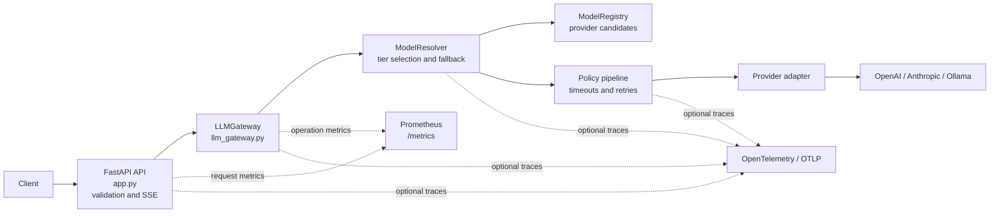

# LLM Gateway

A FastAPI service for OpenAI, Anthropic, and Ollama with model selection,
fallbacks, retries, streaming, metrics, and optional OpenTelemetry tracing.

## Architecture

The request path separates API handling, model selection, retry policy, and
provider integrations:



Model tiers:

- `smart`: Anthropic → OpenAI → Ollama
- `medium`: OpenAI → Ollama
- `light`: Ollama only

## Project layout

```text
src/llm_gateway/
├── app.py                  # HTTP routes, middleware, error responses
├── llm_gateway.py          # LLM operations and operation metrics
├── models.py               # API request and response contracts
├── prometheus.py           # Prometheus metric definitions
├── telemetry.py            # OpenTelemetry setup
├── core/                   # Settings and request logging context
├── resolver/               # Model tiers, registry, fallback orchestration
├── policy/                 # Provider execution, error mapping, retries
└── adapter/                # Provider protocol and OpenAI/Anthropic/Ollama clients
```

## Run

Requires Python 3.14+ and [uv](https://docs.astral.sh/uv/).

```bash
uv sync
uv run llm-gateway
```

The service listens on `0.0.0.0:8000` by default. To run the local Docker
stack, first set a unique `GRAFANA_ADMIN_PASSWORD` in `.env`:

```bash
cp .env.example .env
docker compose up --build -d
```

Compose downloads `qwen3:8b` for Ollama. The gateway, Ollama, Prometheus,
Jaeger, and Grafana are bound to loopback. Jaeger uses in-memory trace storage.

## API

All requests use JSON with a non-empty `prompt` (up to 10,000 characters).
`model` is optional and defaults to `smart`.

Generate text:

```bash
curl http://localhost:8000/generate \
  -H 'Content-Type: application/json' \
  -d '{"prompt":"Say hello in one word","model":"light"}'
```

Example response:

```json
{"text":"Hello","provider":"ollama","model":"qwen3:8b"}
```

Extract a structured review:

```bash
curl http://localhost:8000/extract \
  -H 'Content-Type: application/json' \
  -d '{"prompt":"The service was excellent. Rating: 5","model":"light"}'
```

Stream output as Server-Sent Events:

```bash
curl -N http://localhost:8000/stream \
  -H 'Content-Type: application/json' \
  -d '{"prompt":"Say hello","model":"light"}'
```

Streams emit `chunk` events followed by `done` on success. A failure is sent as
an `error` event; streaming errors may therefore arrive after the HTTP response
has started.

## Configuration

Settings come from environment variables or `.env`; see [.env.example](.env.example).

| Variable | Default | Purpose |
|---|---|---|
| `HOST`, `PORT` | `0.0.0.0`, `8000` | Bind address and port |
| `OLLAMA_BASE_URL`, `OLLAMA_MODEL` | `http://localhost:11434`, `qwen3:8b` | Ollama endpoint and model |
| `OPENAI_API_KEY`, `ANTHROPIC_API_KEY` | unset | Optional cloud credentials |
| `MAX_RETRIES` | `2` | Retry limit for transient failures |
| `CONNECT_TIMEOUT`, `REQUEST_TIMEOUT`, `STREAM_TIMEOUT` | `5`, `60`, `120` seconds | Provider timeouts |
| `MAX_CONCURRENT_REQUESTS` | `50` | Concurrent request limit |
| `OTEL_ENABLED` | `false` | Enable OTLP/HTTP tracing |
| `OTEL_EXPORTER_OTLP_ENDPOINT` | `http://localhost:4318/v1/traces` | Trace receiver |

`CLAUDE_API_KEY` is also accepted as an alias for `ANTHROPIC_API_KEY`.
Provider model names and retry backoff can also be configured; see
`src/llm_gateway/core/config.py`. Missing cloud credentials skip those
providers and allow configured fallbacks.

## Tests and load testing

Run the test suite:

```bash
uv run pytest
```

To collect coverage:

```bash
uv run pytest --cov=src/llm_gateway --cov-report=term-missing tests/
```

Load tests use Locust and the Ollama-compatible mock, not a real model. Install
the development dependencies with `uv sync --dev`, then start the mock and
gateway in separate terminals:

```bash
uv run uvicorn loadtest.mock_ollama:app --host 127.0.0.1 --port 11435
```

```bash
OLLAMA_BASE_URL=http://127.0.0.1:11435 \
OLLAMA_MODEL=mock-model \
OPENAI_API_KEY= ANTHROPIC_API_KEY= \
uv run llm-gateway
```

Run Locust in a third terminal:

```bash
uv run locust -f loadtest/locustfile.py --host http://127.0.0.1:8000
```

## Limitations

- The API has no built-in authentication. Do not expose it publicly without
  network controls and an authentication layer.
- Prompts are limited to 10,000 characters; concurrent requests are capped by
  `MAX_CONCURRENT_REQUESTS`.
- A stream cannot fall back to another provider after its first chunk is sent.
- Local Compose traces are ephemeral and are lost when Jaeger restarts.
